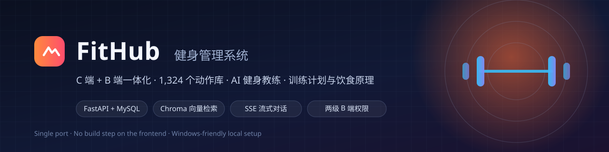
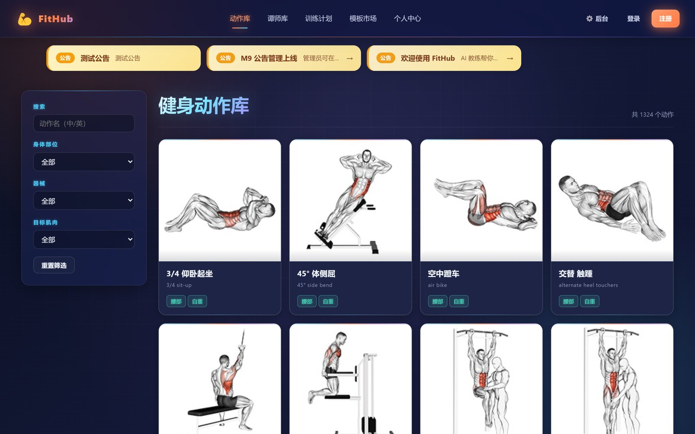
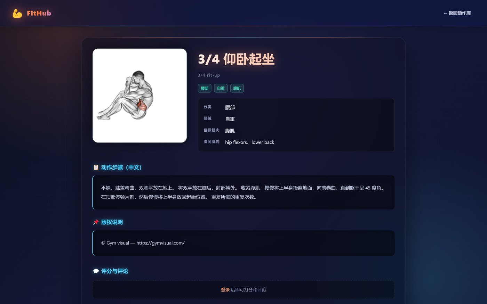
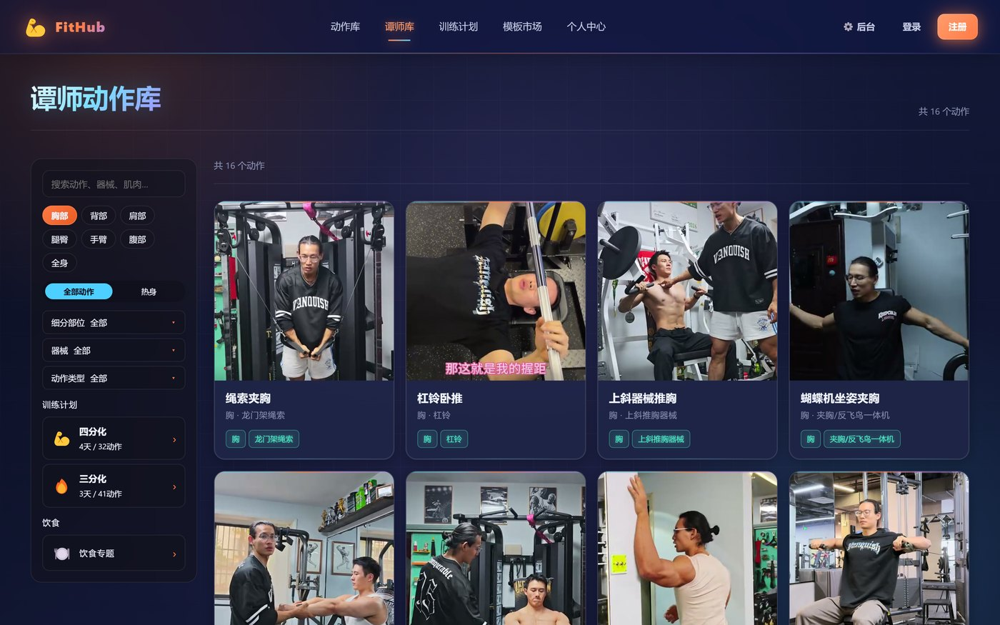
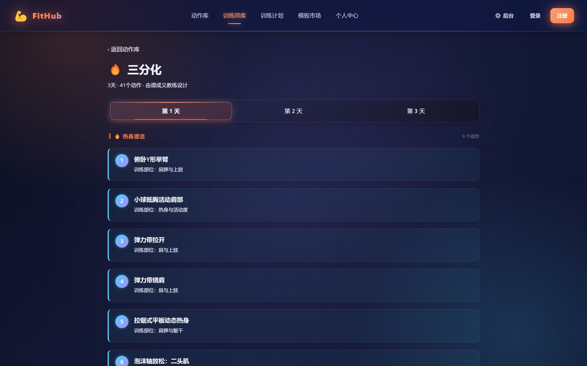
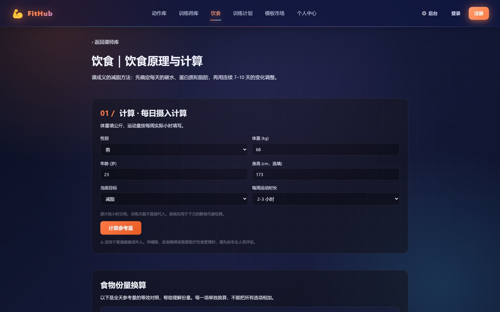
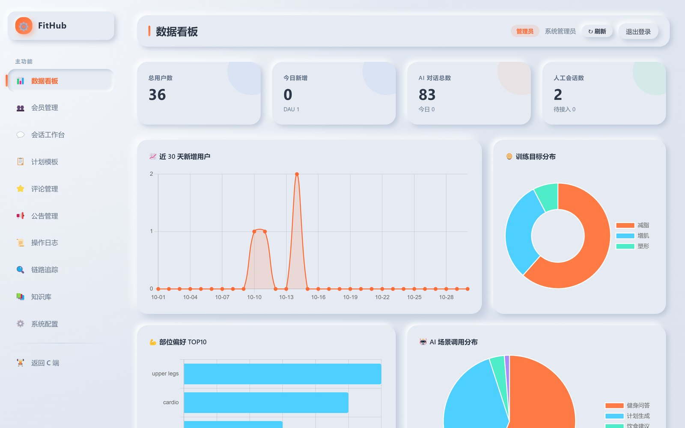
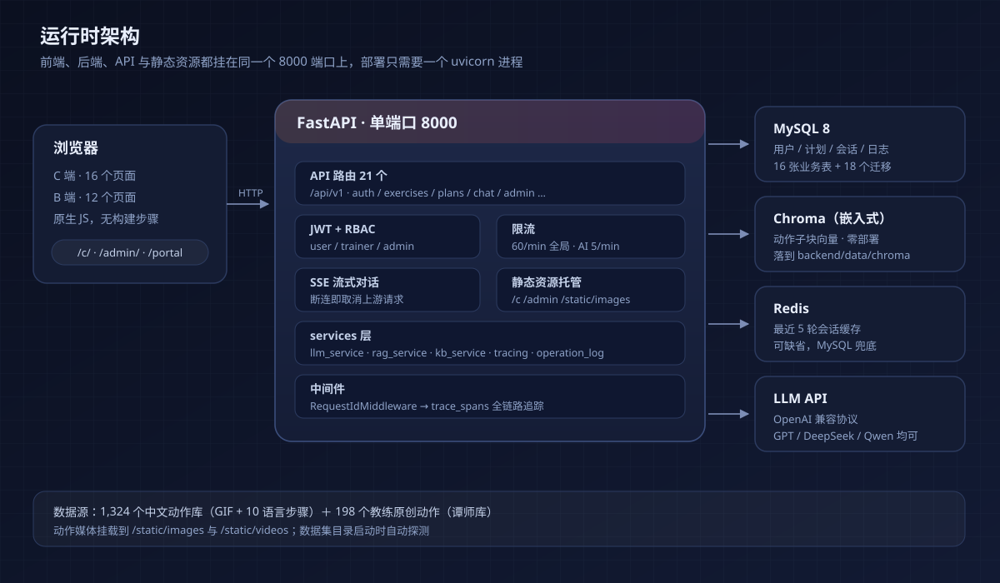
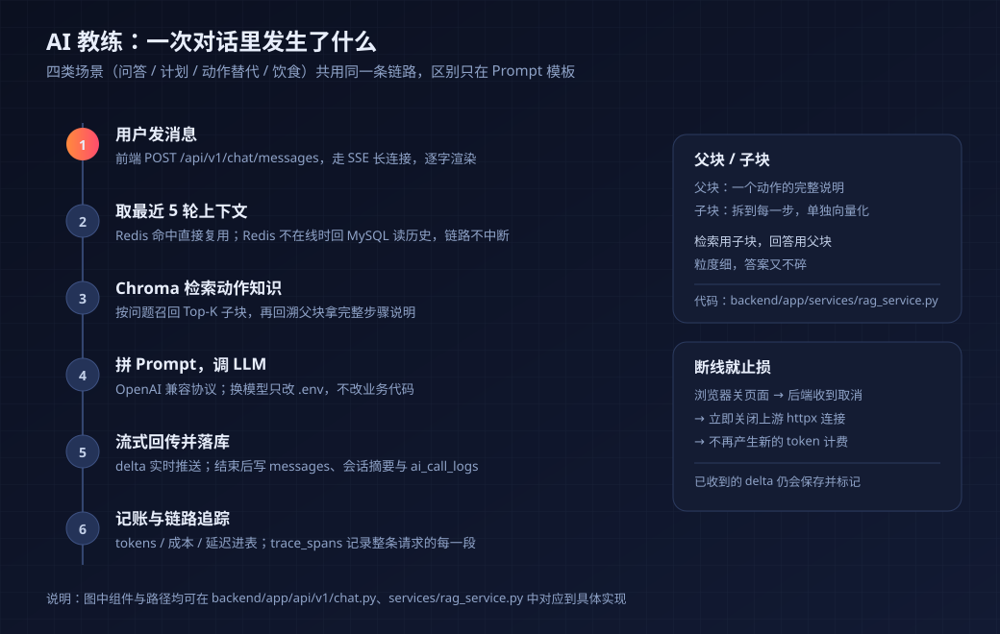

<!-- README_SYNC: source=main (working tree); updated=2026-10-30 -->
<p align="center">
  简体中文 · <a href="./README_EN.md">English</a>
</p>

<p align="center">
  
</p>

# FitHub · 健身管理系统

**给独立教练和小型健身房的自托管系统**：动作库、AI 教练、训练计划、饮食计算和 B 端运营都在同一个 FastAPI 进程里。1,324 个中文动作加 198 个教练原创动作开箱可用，前端没有构建步骤。

<p align="center">
  <a href="https://github.com/lisu0429/Fitness-ManagementSystem/stargazers"></a>
  <a href="https://github.com/lisu0429/Fitness-ManagementSystem/commits/main"></a>
  
  
  
</p>

> 如果这套系统对你有用，可以点一个 Star 收藏下来。它也会帮更多想自建健身系统的人找到这里。

## 这是什么

FitHub 是一个能完整跑起来的健身管理后台：会员在 C 端查动作、跟计划练、和 AI 教练对话；教练在 B 端发计划模板、接管会话；管理员看看板、审模板、翻操作日志和链路追踪。

**适合谁**

- 想自己管会员数据和课程内容的小型健身房、私教工作室；
- 需要一个可改的中文动作库 + AI 教练的开发者；
- 想读一个单进程、无构建链的全栈 FastAPI 项目当参考的人。

**不适合谁**

- 想要开箱即用 SaaS 的人：这里要自己配 MySQL、填 LLM Key；
- 需要支付、排课、门禁、多门店的连锁健身房：这些没做；
- 面向英文市场的产品：界面目前只有中文。

| 数字 | 是什么 |
| --- | --- |
| 1,324 | 中文动作，含 GIF 演示与 10 语言步骤说明 |
| 198 | 教练原创动作（谭师库），带三分化 / 四分化计划与饮食专题 |
| 28 | 前端页面：C 端 16 个 + B 端 12 个 |
| 21 / 16 / 18 | 后端路由模块 / 业务表 / alembic 迁移 |

它和“自己拼一套”的差别只有三条，但每条都决定后面好不好维护：

| 常见做法 | 这里 |
| --- | --- |
| 用 SaaS，课程内容和会员数据都在别人服务器上 | MySQL + 本地文件，备份就是一次 `mysqldump` 加拷贝一个目录 |
| 前端一套服务、后端一套服务，再加一条构建链 | 一个 uvicorn 进程托管 API、两个前端和动作媒体，前端改完刷新就生效 |
| AI 助手单独接一个服务，用户和计划数据要再同步一遍 | AI 与业务同库：直接读用户画像、计划、动作，调用记录写回同一张表 |



*C 端动作库：筛选、搜索、分页都在一个页面里，1,324 个动作共用一个详情模板。*

## 快速开始

需要 Python 3.11+、MySQL 8。Redis 可选——不启动时短期会话回落到 MySQL 读，功能不受影响。

```bash
# 1. Clone (dataset included, ~120 MB)
git clone https://github.com/lisu0429/Fitness-ManagementSystem.git
cd Fitness-ManagementSystem

# 2. Start MySQL (skip if you already have one)
docker run -d --name fithub-mysql \
  -e MYSQL_ROOT_PASSWORD=rootpass -e MYSQL_DATABASE=fithub \
  -p 3306:3306 mysql:8.0 \
  --character-set-server=utf8mb4 --collation-server=utf8mb4_unicode_ci

# 3. Install
cd backend
python -m venv .venv
.venv\Scripts\activate         # macOS / Linux: source .venv/bin/activate
pip install -r requirements.txt

# 4. Configure
cp .env.example .env           # fill in MYSQL_DSN, LLM_API_KEY, JWT_SECRET

# 5. Migrate and seed
alembic upgrade head
python -m app.db.seed_exercises        # 1,324 exercises, idempotent
python -m app.db.create_default_admin  # admin / admin123

# 6. Run
uvicorn app.main:app --reload --port 8000
```

macOS / Linux 用户把 `.venv\Scripts\activate` 换成 `source .venv/bin/activate`，其余命令一致。

打开 `http://localhost:8000/c/` 就是动作库，`/admin/` 是 B 端，`/docs` 是 Swagger。健康检查应该返回 `{"status": "ok"}`：

```bash
curl http://localhost:8000/api/v1/health
```

> 动作图片和 GIF 由 `backend/app/main.py` 在启动时自动探测数据集目录，命中 `images/` 和 `videos/` 就挂到 `/static/images`、`/static/videos`。换了目录就在 `.env` 里设置 `EXERCISES_DATA_DIR`。

## 界面

| 动作详情：GIF、步骤、评分 | 谭师库：教练原创动作与训练计划 |
| --- | --- |
| [](./docs/images/screenshot-detail.jpg) | [](./docs/images/screenshot-tan-library.jpg) |
| **三分化计划：按天分组的热身与正式组** | **饮食：克数计算器与原理视频** |
| [](./docs/images/screenshot-tan-plan.jpg) | [](./docs/images/screenshot-tan-diet.jpg) |



*B 端看板：用户、AI 对话、人工会话、近 30 天趋势，数据来自本机 MySQL 的真实表。*

## 架构



四个决定值得单独说：

- **单端口**。`uvicorn` 同时托管 `/api/v1`、`/c`、`/admin` 和 `/static`，部署就只有“一个进程 + 一个数据库”，没有反向代理也能跑；
- **三层存储**。MySQL 存结构化数据，Chroma 以嵌入式模式存动作子块向量（数据落在 `backend/data/chroma`，不用额外部署），Redis 只缓存最近 5 轮会话，可以缺省；
- **前端无构建**。原生 HTML + CSS + JS，没有 `npm install`，改完刷新就能看到效果；
- **全链路可查**。`RequestIdMiddleware` 给每个请求打 RequestId，写入 `trace_spans`，B 端能按 RequestId 串起整条调用。

## AI 教练的链路



四类场景（问答、计划生成、动作替代、饮食建议）共用同一条链路，区别只在 Prompt 模板。检索用的是父子块策略：

- **父块**：一个动作的完整步骤说明，存 MySQL；
- **子块**：拆到每一步，单独向量化后存 Chroma。检索命中的是子块，返回给模型的是它所属的父块——匹配粒度细，回答又不碎。

两个容易忽略的工程细节：浏览器关掉页面时，后端在 `asyncio.CancelledError` / `GeneratorExit` 上主动关闭上游 httpx 连接，避免用户走了、账单还在涨；每次调用的 tokens、成本、延迟写进 `ai_call_logs`，B 端能直接看到钱花在哪。

## 目录结构

```text
Fitness-ManagementSystem/
├── README.md / README_EN.md      # 中英双语的入口文档
├── SECURITY.md                   # 上线前安全自检清单
├── deploy.md                     # 生产部署（docker-compose + nginx + 回滚）
├── 数据库使用.md                  # MySQL 日常操作与迁移排错
├── nginx.conf / docker-compose*.yml
│
├── web/                          # 前端，无构建
│   ├── c/                        # C 端 16 个页面（index / detail / tan-* / chat …）
│   │   ├── assets/               # 动作静帧与谭师库素材
│   │   ├── css/  js/
│   ├── admin/                    # B 端 12 个页面（dashboard / users / knowledge-base …）
│   └── shared/
│
├── backend/
│   ├── app/
│   │   ├── api/v1/               # 21 个路由模块
│   │   ├── core/                 # 配置、JWT、日志、限流
│   │   ├── db/models/            # 16 张表的 ORM
│   │   ├── services/             # LLM / RAG / 知识库 / 追踪 / 操作日志
│   │   └── main.py               # 应用工厂 + 静态托管 + /portal 入口页
│   ├── alembic/                  # 18 个迁移（head 0018）
│   └── tests/                    # 16 个测试文件 + perf/
│
├── data/exercises-dataset-zh-master/   # 动作数据集（视频 / 图片 / JSON）
├── docs/images/                  # 本文档用到的截图与示意图
└── .github/workflows/ci.yml      # 单测 + 迁移一致性 + lint
```

## API 一览

所有接口统一挂在 `/api/v1` 下，完整 schema 见 `http://localhost:8000/docs`。

| 前缀 | 角色 | 用途 |
| --- | --- | --- |
| `/auth` | 公开 | 注册、登录、刷新 token |
| `/exercises` | user | 动作列表、筛选聚合、详情 |
| `/reviews` | user | 动作评论与 1–5 星评分 |
| `/plans` | user | 训练计划 CRUD 与打卡 |
| `/plan-templates` | user | 教练模板市场与采用 |
| `/chat` | user | AI 对话（SSE 流式，四类场景） |
| `/trainer` | trainer | 模板管理、会话队列 |
| `/admin/*` | admin | 会员、模板审核、看板、日志、追踪、知识库 |
| `/tan-actions`、`/tan-plans`、`/tan-diet` | 公开 | 谭师库动作、训练计划、饮食专题 |

## 权限与边界

| 角色 | 能做什么 |
| --- | --- |
| `user` | C 端全部功能：动作、计划、评论、AI 对话 |
| `trainer` | 发布计划模板、接管 AI 转来的人工会话 |
| `admin` | 会员、模板审核、公告、系统配置、操作日志、链路追踪、知识库 |

- 鉴权用 JWT（Access 2 小时 + Refresh 7 天），路由层用 `Depends(require_role(...))` 卡角色；
- 限流用 slowapi：全局 60 次/分钟，AI 接口 5 次/分钟、50 次/天/用户；
- 所有 B 端写操作进 `operation_logs`，所有 LLM 调用进 `ai_call_logs`；
- API Key、数据库密码只放在 `.env`（已在 `.gitignore` 里），仓库只有 `.env.example` 占位符。

生产部署前请通读 [SECURITY.md](./SECURITY.md)。

## 测试与性能

```bash
cd backend
pytest
pytest tests/test_auth.py -v
pytest -m "not integration"
```

全量跑会自动跳过需要真实 MySQL / Chroma 的集成用例。

16 个测试文件覆盖鉴权、计划、对话、知识库、教练与后台接口；集成测试会自己建 `fithub_test` 库，跑完回滚，不污染数据。

性能基线（2026-10-11，本机 dev + 本机 MySQL，50 并发，`stdlib urllib`）：

| 端点 | p95 | 说明 |
| --- | --- | --- |
| `GET /exercises` | 47.9 ms | 分页列表，最重的一条 |
| `GET /exercises/filters` | 28.5 ms | 筛选聚合 |
| `GET /exercises/{id}` | 24.1 ms | 详情 |
| `GET /plan-templates` | 27.5 ms | 模板市场 |
| `GET /admin/dashboard/overview` | 47.3 ms | 看板聚合 |

这是开发机上的单点数据，不是生产承诺；压测脚本和阈值在 [backend/tests/perf/README.md](./backend/tests/perf/README.md)。

## 还没做的

- **付费会员**：产品决策里明确 MVP 不实现，只预留了字段（D6）；
- **国际化**：界面只有中文（D10）；
- **多门店 / 排课 / 支付 / 门禁**：不在当前范围内；
- **许可证**：仓库目前没有 `LICENSE` 文件，使用与分发范围因此不明确，见文末；
- 生产环境的漂移修复和上线加固仍在进行（M8）。

## 常见问题

<details>
<summary><code>python -m venv</code> 在 conda 环境里报错</summary>

conda 自带的 venv 模块复制 `venvlauncher.exe` 会失败。直接用 conda 建环境：

```bash
conda create -n fithub python=3.11 -y
conda activate fithub
pip install -r requirements.txt
```
</details>

<details>
<summary>知识库上传后状态变成 <code>failed</code>，错误是 <code>"'_type'"</code></summary>

这是 `chromadb==0.6.3` 的配置迁移 bug（迁移后的 collection 配置缺 `_type` 字段）。`requirements.txt` 已锁 `chromadb>=0.5.0,<0.6.0` 避开；如果已经踩到，停服务、清空 `backend/data/chroma/`、重启，让 Chroma 重建 collection。
</details>

<details>
<summary>PowerShell 里 <code>pip install</code> 报 GBK 编码错误</summary>

```powershell
$env:PYTHONUTF8=1
pip install -r requirements.txt
```
</details>

<details>
<summary>动作图片 404，或者目录名是 <code>exercises-dataset-zh-master</code></summary>

GitHub 克隆默认带 `-master` 后缀，zip 解压还可能套两层。`main.py` 会按 `EXERCISES_DATA_DIR` → `data/exercises-dataset-zh` → 嵌套目录的顺序探测，命中 `images/` + `videos/` 就挂载。实在认不出来，就在 `.env` 里显式写 `EXERCISES_DATA_DIR`。
</details>

## 一起改

前端用 CSS Variables + BEM，ES Module 分文件；后端路由只做参数解析，业务逻辑放 `services/`；表结构变更必须走 alembic 迁移。更细的约定写在 [.claude/CLAUDE.md](./.claude/CLAUDE.md) 里，`/db-init` 命令和 `@backend-dev` agent 也是给协作准备的。

发现 Bug 或想加功能，直接开 Issue 描述复现步骤就行。

## 许可证

仓库目前**没有** `LICENSE` 文件——代码默认保留所有权利，这会让“能不能商用、能不能二次分发”变成一句说不清的话。如果你打算开源，建议先补一份许可证，MIT 或 Apache-2.0 都适合这类项目。

另外两部分权利不在本项目手里：动作图片与 GIF 版权归 [Gym visual](https://gymvisual.com/)，中文数据集来自 [wangmuerxiao/exercises-dataset-zh](https://github.com/wangmuerxiao/exercises-dataset-zh)，使用时请遵守上游条款。

## 致谢

- [wangmuerxiao/exercises-dataset-zh](https://github.com/wangmuerxiao/exercises-dataset-zh) — 中文动作数据集
- [hasaneyldrm/exercises-dataset](https://github.com/hasaneyldrm/exercises-dataset) — 原始英文数据集
- [Gym visual](https://gymvisual.com/) — 动作媒体
- [FastAPI](https://fastapi.tiangolo.com/)、[Chroma](https://www.trychroma.com/)、[slowapi](https://github.com/laurentS/slowapi) — 撑起这套东西的轮子

---

<p align="center">
  功能建议、Bug 报告、部署问题都欢迎提 <a href="https://github.com/lisu0429/Fitness-ManagementSystem/issues">Issue</a>。<br>
  如果它省了你几天时间，一个 <a href="https://github.com/lisu0429/Fitness-ManagementSystem/stargazers">Star</a> 就是最实在的反馈。
</p>
